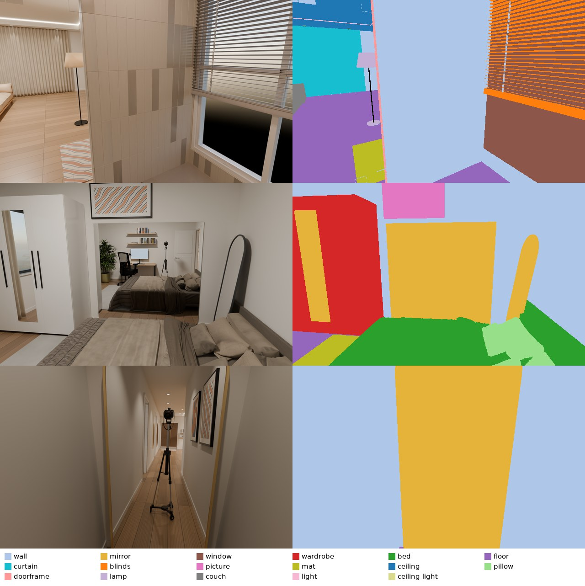
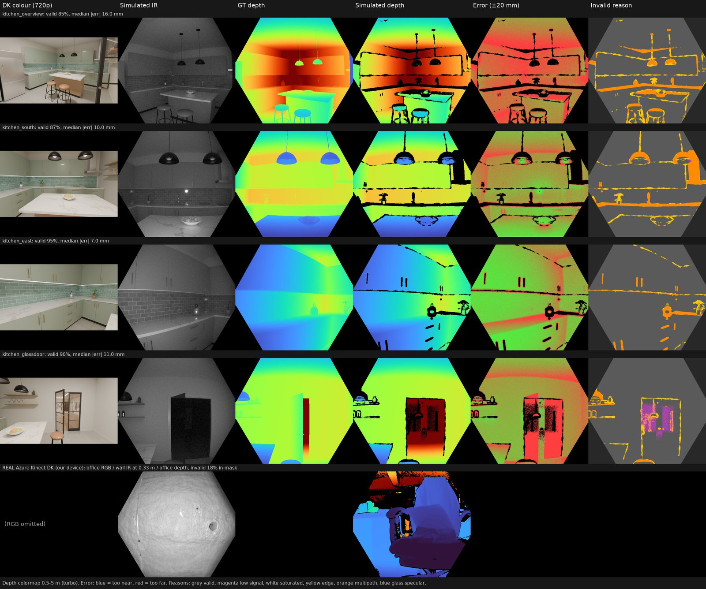

# apartment.blend – dataset pipeline scripts (2026-10-30)

Put this folder next to `apartment.blend` as `output/` (scripts expect `../apartment.blend`).
Blender 4.5 LTS, Cycles + OptiX. Script comments are in Chinese; usage lines are at the top of each file.
The scene setup below is **already saved in the blend** – re-run only to change it (`SAVE=1` saves).

## Scene setup (already applied)
| Script | What it does |
|---|---|
| `upgrade_rig.py` | Detailed camera/tripod/dolly prop visible in mirrors (`Cam_MirrorTour_Rig`) |
| `vggt_settings.py` | Render settings: 512 spp adaptive 0.01, clamp indirect 5, glossy 8, 16-bit PNG, no DoF/motion blur |
| `dataset_setup.py` | Light groups (6 rooms + Sky + Misc), instance IDs (`pass_index`), semantic labels (custom 30 + ScanNet200 → NYU40 / ScanNet20), GT passes, stereo (parallel, 0.12 m, `BASELINE=`) |
| `lighttour_setup.py` | `Cam_LightTour`: A Living → B Bedroom1 → C Bedroom2 → A, 1116 frames; Living lights off at frame 790; start/end pose identical |
| `scannet_labels/` | Official ScanNet200 constants + `scannetv2-labels.combined.tsv` (source in `SOURCE.txt`); `label_review.md` = labelling choices to confirm |

## Rendering
```bash
# Stereo + all GT, e.g. every 10th frame of the mirror tour
blender -b apartment.blend --python output/render_dataset.py -- OUT --camera Cam_MirrorTour --step 10
# Light tour with lights-off scenario (defaults read from the camera)
blender -b apartment.blend --python output/render_dataset.py -- OUT --camera Cam_LightTour --step 10
# Semantic maps (all label sets) + optional preview sheets
blender -b --factory-startup --python output/postprocess_dataset.py -- OUT [--preview]
```
Per frame and eye (`_L`/`_R`): `frames/` RGB, `depth/` Z-depth EXR (m), `normal/` world normals,
`albedo/`, `shading/`, `instance/`, `passes/` (raw light passes + per-room light groups),
`scenario/` (lights-off composite); plus `cameras.json` (K, c2w Blender, w2c OpenCV), `labels.json`, `lighting.json`.

Example: left RGB and `semantic_scannet200/` (frames 1075 / 2025 / 2690). Mirrors are labelled as `mirror` as a whole,
reflected content is not segmented.



## Azure Kinect DK simulation (`kinect_dk/`)
Calibrated from a real DK (NFOV unbinned 640×576 + 720p color; factory calibration in `factory_calibration.json`).
```bash
# 1) once: fit valid-area mask, IR falloff, noise from real recordings -> dk_params.npz/json (needs numpy + cv2)
python3 output/kinect_dk/calibrate_dk.py /path/to/AzureKinectDK/output
# 2) render color + IR/depth-camera passes (blend file is not modified)
blender -b apartment.blend --python output/kinect_dk/render_kinect.py -- OUT [--views name=x,y,z,lx,ly,lz;...]
# 3) add sensor effects (noise, multipath, glass, edge dropout, low signal); seconds, no re-render
python3 output/kinect_dk/kinect_sim.py OUT [--preview]
```
Per view: `depth.png` (uint16 mm, 0 = invalid), `ir.png`, `depth_gt.png`, `depth_to_color.png`,
`invalid_reason.png` (1 outside FoV, 2 low signal, 3 saturated, 4 edge, 5 multipath, 6 glass); `rig.json` has K, distortion, extrinsics.
Model parameters are in `PARAMS` of `kinect_sim.py`. Multipath, saturation and IR noise are still estimates.

Kitchen test (4 views). Columns: DK colour, simulated IR, GT depth, simulated depth, error, invalid reason.
Bottom row: our real DK for reference (wall IR at 0.33 m, office depth).



## Other
- `preview_tour.py`, `lighttour_sheet.py` – quick low-res light-tour preview / key-frame sheet
- `render_vggt.sh/.py`, `render_sampled.sh/.py` – earlier mono VGGT pipeline (render → video → zip → Baidu)
